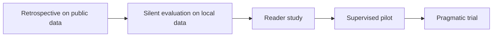

# Clinical Validation

**No clinical validation has been done.** It cannot be completed in the first four weeks. Each study below needs ethics approval, a NACOSTI licence and institutional agreement. The sequence follows DECIDE-AI and SPIRIT-AI thinking [G4, G5].

## Stages



Each stage needs a stop-or-go review. Stage 2 onward needs the compliance gates in [Product requirements](PRODUCT_REQUIREMENTS.md).

## Study A: silent local evaluation

Run the model on de-identified local images, inside Kenya, with results not shown to clinicians.

- **Question:** how do international models perform on Kenyan images?
- **Reference:** at least two radiologists, with third-reader adjudication.
- **Outcomes:** the metrics in [Model evaluation](MODEL_EVALUATION.md), per finding and subgroup.
- **Sample size:** driven by the precision of sensitivity. To estimate a sensitivity near 0.90 within ±0.05 at 95% confidence needs about 138 patients **with** that finding: 1.96² × 0.9 × 0.1 / 0.05². Scale up for prevalence. If a finding occurs in 5% of studies, you would need roughly 2,800 studies, or an enriched sample with declared enrichment.

## Study B: reporting efficiency

**Design: randomised multireader, multicase crossover.**

| Element | Design |
|---|---|
| Group A | Conventional reporting |
| Group B | AI-assisted reporting with human review |
| Readers | Practising authorised reporters. Include varied experience |
| Cases | Same case set in both arms, in randomised order |
| Washout | At least several weeks, to reduce recall. Seah et al. used 3 months [C6] |
| Randomisation | Readers to order. Cases to arm per session |
| Blinding | Readers cannot be blinded to the arm. Assessors of report quality are blinded |

**Why crossover?** Reporters differ widely. Each acts as their own control. A simple sequential comparison, unaided then aided, confuses the AI effect with practice and fatigue.

### Outcomes

| Type | Outcome |
|---|---|
| Primary | Time to produce a report, automatically logged |
| Co-primary safety | Clinically significant error rate. Non-inferiority margin agreed before the study |
| Secondary | Editing time; report turnaround; diagnostic agreement; report completeness; reader satisfaction; NASA-TLX workload |

### Analysis

Mixed-effects model on log time, with reader and case as random effects, and arm and period as fixed effects. For accuracy, multireader multicase methods such as Obuchowski-Rockette.

### Sample size (illustrative only)

For paired mean difference in seconds:

```text
n = (z_α/2 + z_β)² × 2σ²(1 − ρ) / δ²
```

Taking σ = 20.4 s from one earlier reader study [C3], ρ = 0.5 (assumed), δ = 5 s (assumed minimum useful difference), α = 0.05 and 80% power:

```text
n ≈ 7.84 × 2 × 416 × 0.5 / 25 ≈ 131 paired reports
```

This ignores clustering by reader and case, so the real number is larger. Time data are skewed. **Run a pilot to estimate variance, and consult a statistician.** Few readers is the main threat: 5 readers cannot represent a profession, however many cases they read. The error outcome will usually need more cases than the time outcome.

### Do not assume a time reduction

Time may rise, particularly with reader-first review or poor drafts. Reporting that is a valid outcome. Earlier results [C2, C3] came from different systems, settings and workflows.

## Study C: unsupported findings rate

- **Sample:** to estimate a rate around 10% within ±3% at 95% confidence needs about 384 reports: 1.96² × 0.1 × 0.9 / 0.03².
- **Assessors:** two radiologists, with adjudication.
- Report clustered intervals if several sentences come from one report.

## Study D: effect of human review

Does review catch AI errors? Seed drafts with known errors, with reader consent and disclosure after the study. Measure the catch rate. This measures automation bias directly, and needs careful ethics design.

## Stage: supervised pilot

Only after A to C are satisfactory. Reports continue through the normal route, with assistance alongside. Protocol to SPIRIT-AI standards [G4]. Report to CONSORT-AI if it is a trial [G3].

## Limits to declare

Single-country results, small reader groups, enriched cases, the Hawthorne effect, and the difference between a reader study and real practice.

## Stopping rules

Define before starting: for example, a critical miss pattern, unacceptable subgroup failure, or a privacy breach. A safety monitor who is independent of the project has the authority to stop.
