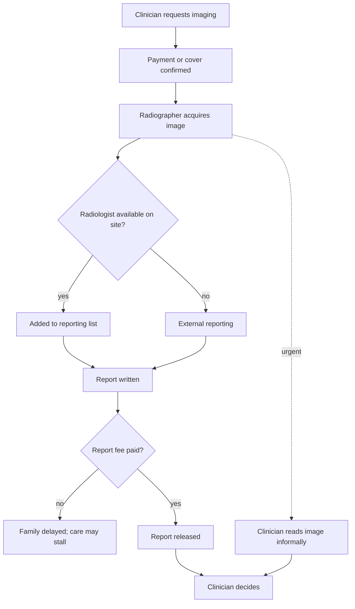
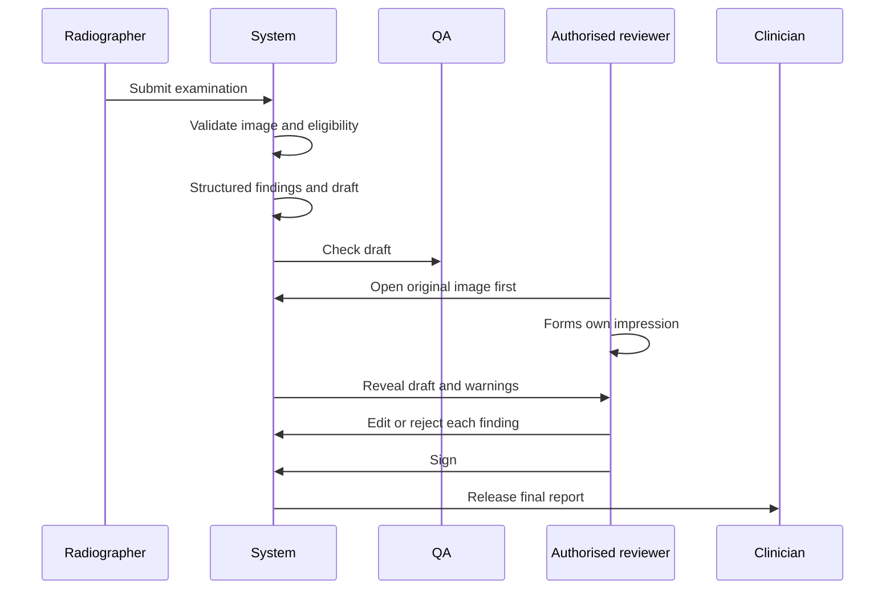
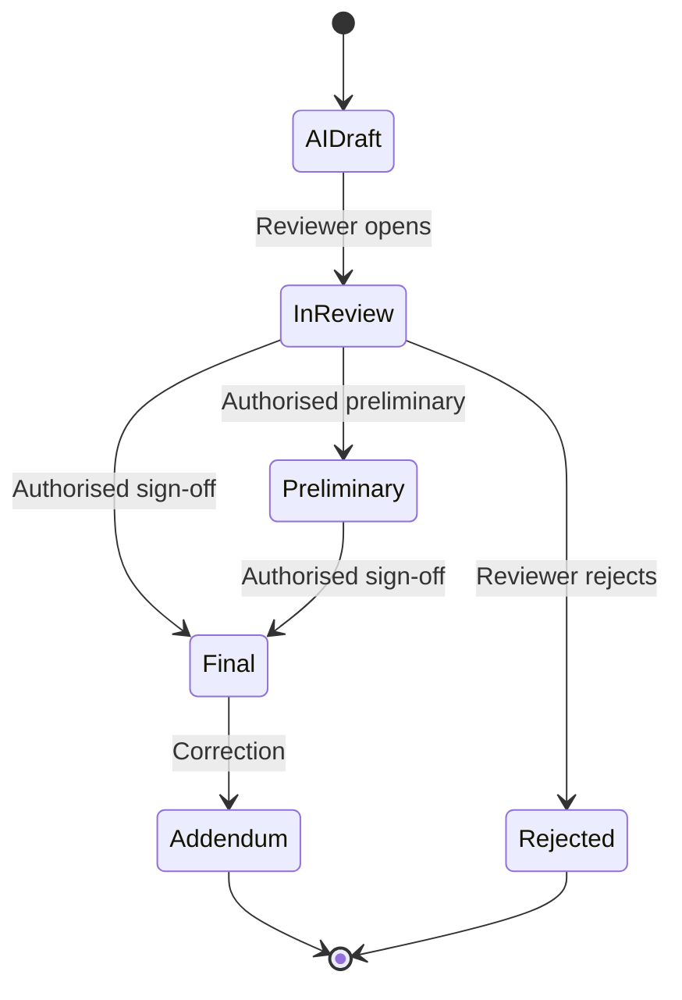

# Clinical Workflow

The current-state map below comes from the project lead's description. **It has not been checked by observation at any facility.** Mapping it properly is Week 1 work and Research Study 1.

## Current workflow (assumed)

## Where delays may occur

| Point | Possible delay | Would AI help? |
|---|---|---|
| Payment before imaging | Family raising funds | No |
| Acquisition | Queue, equipment | No |
| Getting images to a reader | CD, film, network | No; a transfer problem |
| Waiting on the list | Volume, staffing | Possibly, through prioritisation or faster reporting |
| Writing | Dictation, typing | Possibly |
| Payment before release | Report fee | Only if policy changes |
| Getting the report to the clinician | Paper, phone | Workflow, not AI |

Note how few of these are AI problems. That is why the pathway should be measured first.

## Proposed assisted workflow

### Reader-first review

The reviewer sees the image before the draft. This costs some time, and exists to reduce anchoring on AI errors [C7, C8]. It is a study variable, not a settled rule. The field trial should compare reader-first with draft-first if the numbers allow.

### Forcing functions

- No sign-off until the image has been opened.
- Every `not_assessed` section must be addressed.
- The sign-off records the reviewer's identity, registration and role.
- Fully unchanged drafts are tracked as a safety signal, not as a success metric.

## Report status

There is no timed path. Drafts cannot age into reports.

## Critical findings

**Research design only. No live alerts in Phase 1.** An alert requires a validated finding and an approved local policy.

| Stage | Requirement |
|---|---|
| Eligibility | Only findings with validated local performance: for example pneumothorax, significant intracranial haemorrhage |
| Routing | To the on-duty authorised reader first |
| Escalation | Named backup at a set time, by phone |
| Acknowledgement | A person confirms receipt. An unacknowledged alert escalates |
| Downtime | Usual process continues. The system's silence is not reassurance |
| Rule | **The absence of an alert means nothing.** Even a large-scale tool had 72.7% sensitivity for unexpected pneumothorax [C2]. Clinical care can never depend on an AI alert alone |

## Effect on healthcare workers

| Role | Possible gain | Possible cost |
|---|---|---|
| Radiologist | Less typing, consistency | Added checking, liability, deskilling |
| Radiographer | Quality feedback | Extra steps |
| Requesting clinician | Earlier report | False confidence |
| Admin | Turnaround data | Misuse of metrics |

## Questions for field observation

- Who actually reads images when no radiologist is available?
- How do images move between sites?
- When in the process are fees collected?
- What are the real reporting volumes and shifts?
- How do clinicians handle a report that disagrees with the patient?
