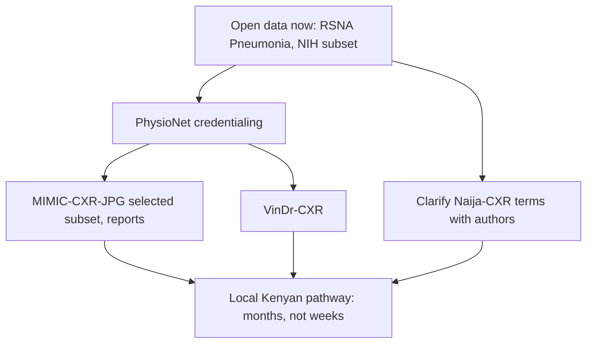

# Data Acquisition Guide

## Order of work

## Step 1: Open data

1. Read the terms and save a dated copy in `datasets/registry/`.
2. Download the smallest useful subset to the local machine or object storage, not the VPS.
3. Record checksums and add a registry entry.
4. Keep a `manifest.csv` of files used.

## Step 2: PhysioNet credentialing (the project lead must do this personally)

1. Create a PhysioNet account.
2. Complete the CITI "Data or Specimens Only Research" course.
3. Apply for credentialing, naming a reference or supervisor.
4. Sign the data use agreement for each dataset.

Credentials are personal and must not be shared. Everyone who touches the data needs their own.

### Rules that follow from the licence [L13, L14]

| Rule | What it means here |
|---|---|
| No sharing access | Do not give anyone else the files or a login |
| Research purpose | Use is framed as "lawful use in scientific research". Do not assume product use is allowed |
| Share code for publications | Code behind any paper using this data must go in a repository open to researchers. **So paper code cannot live only in the private repository** |
| No re-identification | Report any identifying information found to PHI-report@physionet.org |
| Online services | Credentialed data must not be pasted into consumer chat tools or ordinary hosted LLM APIs. PhysioNet describes conditional routes through certain cloud services. Re-read the page before any LLM use |
| Keep training current | Maintain certification |

**Rented GPUs.** Whether a shared marketplace GPU host counts as giving a third party access is unresolved. Use a major cloud under contract, or a provider's secure tier, and encrypt data. Do not use community-hosted machines for credentialed data.

## Step 3: Bulk download strategy

Do not download everything. MIMIC-CXR-JPG alone is about 558 GB (secondary), and the VPS disk is 75 GB. Pick a frontal-view, patient-level subset, downsample, and work there. See [Storage strategy](STORAGE_STRATEGY.md).

## Step 4: Kenyan data plan

**No hospital has been contacted and no data has moved.** Do not begin any of this without the approvals below.

### Stage A: preparation

1. Find a **Kenyan radiologist co-investigator**. This comes first.
2. Identify an institutional supervisor and a NACOSTI-accredited ethics committee.
3. Obtain a legal opinion on the matters in [Privacy and regulation](PRIVACY_AND_REGULATORY.md).

### Stage B: approvals

| Approval | From | Note |
|---|---|---|
| Institutional approval | The facility | Names responsible provider. Health data may only be processed by or under the responsibility of a provider, or under professional secrecy (DPA s.46) [L1] |
| Ethics review | Accredited ERC | Required before NACOSTI. Check waiver options for retrospective data |
| Research licence | NACOSTI | Fees and process: confirm directly |
| DPIA | Controller | Required before high-risk processing (DPA s.31) |
| Consent or approved waiver | ERC | Children's data needs parent or guardian consent (DPA s.33) |
| Data sharing agreement | Facility and project | Ownership, purpose limits, destruction, publication rights |
| Digital Health Agency | If drawing on the national System | Research requests need ethics approval and a NACOSTI licence; fees apply (LN 76/2025 Second Schedule) [L3] |

### Stage C: handling

- **Compute goes to the data.** Evaluate on a secure machine inside Kenya under facility control. Export only aggregate results.
- De-identify before anything leaves clinical systems. See [DICOM guide](DICOM_GUIDE.md).
- Burned-in text on images must be checked, not just header tags.
- Encrypt at rest and in transit, and log access.
- Radiologist annotation: at least two independent readers, with adjudication by a third. Agree the labelling manual first.
- Agree publication and authorship rights before data collection.

### What not to do

- Do not transfer Kenyan images to the EU VPS, cloud GPUs or any LLM service, even if pseudonymised, until written legal advice says it is lawful.
- Do not assume removing the name makes data anonymous. Under the Act, anonymised means the person is no longer identifiable.
- Do not use your own clinical access to obtain images for this project.

## Provenance registry

Every sample needs traceable origin. Fields are defined in [Data dictionary](DATA_DICTIONARY.md). Separate `raw/`, `derived/` and `results/`. Raw is read-only.
