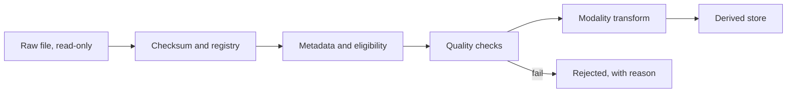

# Data Preprocessing

Rule: preprocessing is part of the model. A model is only valid with the preprocessing it was trained on. Change it and you have a new model that needs re-evaluation.

Rule: originals are never altered. Every derived file records its parent and its pipeline version.

## Pipeline overview



## Chest X-ray (Phase 1)

| Step | Decision | Reason |
|---|---|---|
| View | Frontal for first baseline; keep the view label | Most models expect frontal |
| Pixel values | Apply rescale and LUT if present; invert `MONOCHROME1` | Avoid inverted input |
| Bit depth | Keep 16-bit in derived source when possible; 8-bit only where model requires | Preserve subtle contrast |
| Crop | Centre crop for TorchXRayVision input | Must match pretrained expectation |
| Resize | 224×224 for DenseNet baseline | **Small nodules and subtle pneumothorax can vanish at this size**. Reviewer always sees full resolution |
| Normalise | `xrv.datasets.normalize(img, 255)` for 8-bit input, into [-1024, 1024] | Library contract [M2] |
| Channels | Single channel | Library contract |
| Augmentation, training only | Small rotation, brightness, contrast | Mimics variation |
| Never augment | Left-right flip | Moves heart and stomach bubble; corrupts laterality |

**Baseline loading sketch** (research, public data only):

```python
import skimage.io, torch, torchxrayvision as xrv

img = skimage.io.imread("public_example.jpg")
img = xrv.datasets.normalize(img, 255)
if img.ndim == 3:
    img = img.mean(2)
img = img[None, ...]
img = xrv.datasets.XRayCenterCrop()(img)
img = xrv.datasets.XRayResizer(224)(img)

model = xrv.models.DenseNet(weights="densenet121-res224-all")
with torch.no_grad():
    scores = model(torch.from_numpy(img)[None, ...].float())[0]
print(dict(zip(model.pathologies, scores.tolist())))
```

Outputs are model scores, not diagnoses and not calibrated probabilities. With single-dataset weights, outputs that dataset did not train are effectively random. Only the `all` weights train every output [M2].

## Quality checks

Automated flags go to `quality_flag`:

- blank or near-constant image;
- very low contrast or saturation;
- wrong body part (a simple classifier);
- inverted image;
- lateral view where frontal is required;
- burned-in text;
- screen photograph, phone capture.

A flagged image reports "limited" rather than a normal-looking output. An image the model cannot judge is not a negative study.

## Abdominal X-ray (Phase 2)

Separate pipeline. Keep higher resolution. Supine vs erect affects air-fluid levels, so view must be known. Do not reuse CXR weights without re-validation.

## CT (Phase 3)

1. Convert to Hounsfield units with slope and intercept.
2. Check geometry, slice order and even spacing.
3. Resample to agreed spacing. Record interpolation.
4. Apply channels of windows for brain: for example brain, subdural and bone. Fix these values before training, with a radiologist.
5. Work with the volume. Do not treat slices as independent examinations.
6. Normalise within a fixed HU range.

Split by patient. Patch-level augmentation must not cross patient boundaries.

## MRI (Phase 4)

1. Identify sequences from metadata, and verify, because names vary by scanner.
2. Reorient to a standard frame such as RAS.
3. Co-register sequences.
4. Skull-strip only where justified. Stripping can remove useful extra-axial findings and is a privacy step for face removal.
5. Correct bias field.
6. Normalise per volume, for example z-score over tissue, since MRI has no absolute unit.
7. Handle missing sequences explicitly. Do not silently substitute.

BraTS-style processed data is already registered and skull-stripped. Performance on it may not transfer to raw clinical scans.

## Multi-view examinations

Keep the study as the reporting unit. Report-level output combines views. Rule: a finding seen on one view stays linked to that view.

## Reproducibility

- Pipeline code versioned, with a fixed `PIPELINE_VERSION`.
- Hash of input manifest plus pipeline version identifies each derived set.
- Random seeds recorded.
- Container or lock file records versions.
