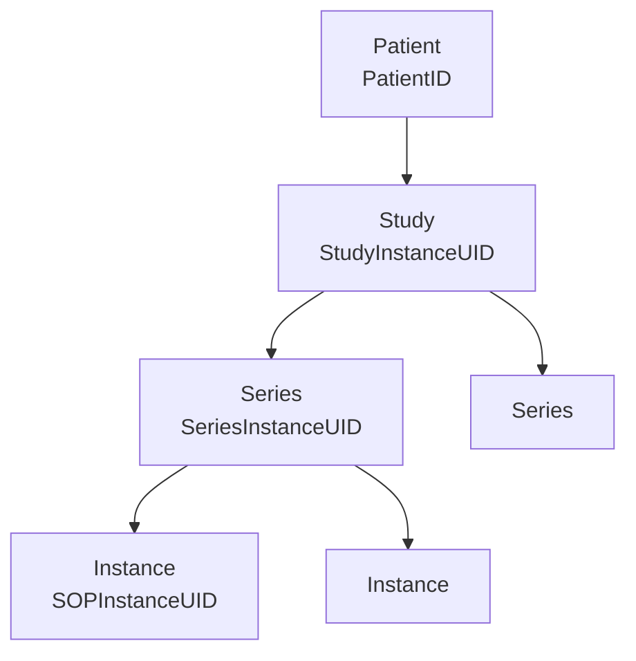

# DICOM Guide

DICOM is both a file format and a network protocol. Think of it as an image bundled with its own request form and technique note.

## Hierarchy



## Tags you need to know

| Keyword | Tag | Why it matters |
|---|---|---|
| PatientID | (0010,0020) | Identifier. Must be removed or replaced |
| PatientName | (0010,0010) | Identifier |
| PatientBirthDate | (0010,0030) | Identifier; drives age check |
| PatientAge | (0010,1010) | Eligibility |
| StudyDate | (0008,0020) | Possibly identifying. Shift or coarsen |
| AccessionNumber | (0008,0050) | Links to RIS. Identifier |
| Modality | (0008,0060) | `CR`, `DX`, `CT`, `MR` |
| BodyPartExamined | (0018,0015) | Often unreliable. Verify |
| ViewPosition | (0018,5101) | `PA`, `AP`, `LL` |
| PhotometricInterpretation | (0028,0004) | Inversion risk |
| BitsStored | (0028,0101) | Real depth |
| PixelRepresentation | (0028,0103) | Signed or unsigned |
| PixelSpacing | (0028,0030) | CT and MR in-plane spacing |
| ImagerPixelSpacing | (0018,1164) | Projection X-ray at the detector. Differs from PixelSpacing |
| WindowCenter, WindowWidth | (0028,1050), (0028,1051) | Display window |
| RescaleSlope, RescaleIntercept | (0028,1053), (0028,1052) | Convert to Hounsfield units |
| ImageOrientationPatient | (0020,0037) | Direction in space |
| SliceThickness | (0018,0050) | Partial volume |
| BurnedInAnnotation | (0028,0301) | Warns of text in pixels. Do not trust a "NO" |

## Reading a file safely

```python
import pydicom

ds = pydicom.dcmread("example.dcm")   # public or synthetic test files only
print(ds.Modality, ds.get("ViewPosition", "UNKNOWN"))
print(ds.PhotometricInterpretation, ds.BitsStored)
pixels = ds.pixel_array
if ds.PhotometricInterpretation == "MONOCHROME1":
    pixels = pixels.max() - pixels      # make high values bright
```

Clinical analogy: never read the image without reading the label. Check it is the right patient, right view and right orientation before interpreting.

## De-identification

Removing headers is not enough.

1. Apply the **DICOM PS3.15 Attachment E** confidentiality profile as the baseline.
2. Replace UIDs consistently, so that study structure survives.
3. Shift dates by a per-patient offset, if the protocol allows.
4. Clear private tags unless you have reviewed them.
5. **Inspect pixels** for burned-in names, dates and hospital markers. Use OCR plus manual review of a sample.
6. Check free-text tags such as `StudyDescription` and `ImageComments`.
7. Log what was done. Keep any re-linking key separately, under the custodian's control.
8. Have a second person check a sample.

Pseudonymised data is still personal data if a key exists. Under Kenyan law, anonymised means the person is no longer identifiable [L1].

## Beyond images

| Object | Purpose | Here |
|---|---|---|
| DICOM SR | Structured report, with coded findings | Long-term export for reports. Consider TID 1500 for measurements |
| DICOM SEG | Segmentation stored as an object | For later CT and MRI work |
| DICOMweb | Web retrieval: QIDO-RS, WADO-RS, STOW-RS | Viewer and integration route |
| C-STORE, C-FIND, C-MOVE | Traditional network services | Common on older PACS |

## Integration vocabulary

- **PACS** stores and serves images.
- **RIS** manages radiology orders and scheduling.
- **HIS or EMR** holds the patient record.
- **HL7 v2** messages carry orders and results.
- **FHIR** is a modern API standard. `ImagingStudy` and `DiagnosticReport` are the relevant resources.

Many Kenyan facilities may have no PACS. Field work should establish how images move in practice: CD, printed film, photo of a screen or messaging apps. Those routes have their own quality and privacy risks.

## Validation at ingestion

The system must reject or flag a study when:

- modality is unsupported;
- age is under 18 or unknown, for the Phase 1 module;
- the body part is not chest, after an image-based check;
- pixel data is missing or a screen photograph;
- the image is lateral only and the model needs a frontal view;
- identifiers are found in a research workflow.
