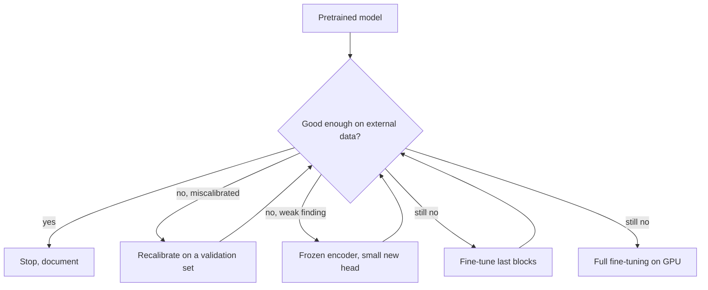

# Model Training Guide

**You may not need to train anything at first.** Week 3 runs a pretrained model and evaluates it. Training comes only when evaluation shows a specific gap.

## Decision ladder



Each step down costs more. Stop when good enough.

## Terms in clinical language

| Term | Meaning |
|---|---|
| Epoch | One pass through the training set |
| Loss | How wrong the model is; training lowers it |
| Learning rate | Size of each correction. Too large overshoots, like over-titrating a drug |
| Overfitting | Memorises training cases, then does poorly on new ones. A student who learned past papers by heart |
| Calibration | Whether "70%" means right about 70% of the time |
| Frozen encoder | Keep the pretrained feature extractor, train only the final layer |

## Rules

1. **Split at patient level.** The same patient must never appear in two splits.
2. **Set aside the test set first**, and touch it once.
3. **Choose thresholds on the validation set**, never the test set.
4. **Handle missing labels**: mask them. Do not treat blanks as negatives.
5. **Deal with imbalance** by using loss weighting and PR-AUC, not only by accuracy.
6. **No left-right flips.**
7. **Fix seeds** and log them.
8. **Stratify** by finding and site where possible.

## Patient-level split

```python
from sklearn.model_selection import GroupShuffleSplit

splitter = GroupShuffleSplit(n_splits=1, test_size=0.2, random_state=42)
train_idx, test_idx = next(splitter.split(df, groups=df["patient_key"]))
assert set(df.iloc[train_idx].patient_key).isdisjoint(df.iloc[test_idx].patient_key)
```

## Leakage checklist

- Same patient across splits.
- Pre-computed statistics from the full dataset.
- Picking the threshold on test data.
- External set is derived from training data. **RSNA Pneumonia comes from NIH images, so it is not external for any model trained on NIH data.**
- Site markers or lines acting as shortcuts.

## Where to run

| Task | Where |
|---|---|
| Debug on 100 images | Laptop CPU |
| Pretrained inference on thousands of images | Laptop or a free notebook GPU, overnight |
| Calibration, small heads | CPU or free notebook |
| Fine-tuning | External GPU |
| Vision-language inference | External GPU |

Do not put credentialed data on free notebooks without checking that this satisfies the licence.

## Practical GPU notes

Save checkpoints often. Marketplace machines can vanish. Keep images in a compressed form to reduce transfer. Stop the instance when finished, because billing continues.

## What must be recorded

Everything in [Experiment tracking](EXPERIMENT_TRACKING.md), including the licence lineage of every input.

## CT and MRI later

3D models need far more memory. Start from MONAI bundles, with patch-based training and a validated label. Do not begin until Phase 1 is evaluated.
