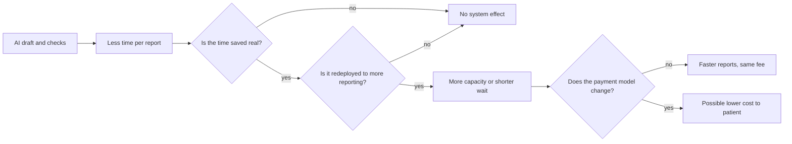

# Problem Statement

## The statement

Medical imaging is essential to modern diagnosis, yet in many resource-constrained settings patients and clinicians cannot rely on timely, affordable and consistently high-quality interpretation. The problem extends beyond acquiring an image. It includes interpreting the image, producing a reliable report, communicating findings, and making the report available within a clinically useful time.

This creates an opportunity to investigate whether clinically supervised AI can improve the efficiency, consistency and accessibility of reporting. It does not establish that AI will.

## What is known

| Claim | Evidence | Status |
|---|---|---|
| LMICs have large imaging equipment and workforce shortages | Frija et al. report less than one CT scanner per million people in LMICs, against almost 40 in high-income countries [H1] | Secondary reading of the paper |
| Imaging capacity is a global policy problem | *Lancet Oncology* Commission [H2] | DOI verified, findings not re-read |
| Kenya has few radiologists, concentrated in cities | News sources give conflicting counts: under 150, about 200, and an outlying 1,400 | **Unverified. No figure should be cited until obtained from KMPDC or WHO data** |
| Report delay harms Kenyan patients | No Kenyan measurement found | **Unknown. Study 1 addresses this** |
| Reporting fees block care | Project lead's observation | **Hypothesis** |

Reported SHA imaging tariffs are MRI Sh11,000 and CT Sh6,900 or Sh9,600, depending on the source and date. These are secondary, and they need checking against the gazetted schedule. No published tariff or rule for a separate reporting fee was found.

## The precise problem AI can realistically address

Reporting has several parts, and AI fits some better than others.

| Part of reporting | Can AI realistically help? | Why |
|---|---|---|
| Finding image abnormalities | Partly | Good evidence for some findings, with known failures on complex studies [C5] |
| Writing up routine text | Plausibly | A draft may save documentation time. Evidence is early [C2, C3] |
| Catching errors in reports | Plausibly | Rule-based checks need no image model. Effect not yet measured |
| Prioritising a work list | Plausibly | Depends on validated urgent-finding detection |
| Integrating clinical context | Poorly | Needs a clinician and information the model lacks |
| Taking responsibility | No | Legally and ethically human |
| Setting fees | No | Policy and business decisions |
| Creating radiologist capacity | Indirectly at most | Only if time saved is real and redeployed |

**The precise problem for Phase 1:** can structured, evidence-grounded AI drafting and independent quality checking reduce the effort of authorised reporters on adult chest radiographs, without increasing clinically significant error, in Kenyan settings?

## Mechanisms by which AI might help access

Each is a hypothesis with a condition attached.

The risks run the other way too. Review time may rise if drafts are poor. Automation bias may let errors through [C7, C8]. Compliance, validation, hosting and liability all cost money. A new fee could be added to the patient's bill rather than removed.

## Who is affected

Patients and families; requesting clinicians; radiologists; radiographers; facilities and counties; and payers including SHA.

## What success would look like

Stated before any data exists, so it cannot be redefined later:

1. **Safety:** no increase in clinically significant error compared with usual reporting.
2. **Efficiency:** a measured reduction in reporter time, with a confidence interval.
3. **Local validity:** documented performance on African data, including where it fails.
4. **Access:** a measured change in report turnaround.
5. **Cost:** an explicit account of who gains or pays, including compliance costs.

Failure on any of these is a publishable result.

## Open questions

- What is the real distribution of report turnaround in Kenyan facilities?
- What share of imaging goes unreported?
- What does a report cost, and who pays?
- Are unreported images read informally by requesting clinicians? That would change the target user.
- Which matters more to clinicians: faster reports, better reports, or any report at all?
