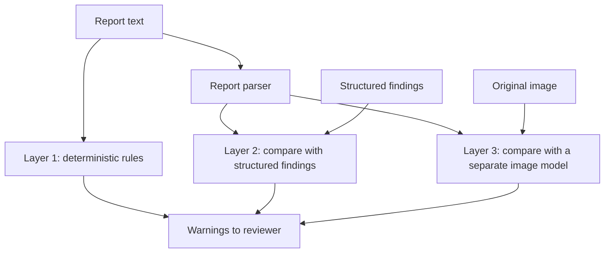

# Report Quality Assurance

## Purpose

A separate module that checks reports, whoever wrote them. It may be the most valuable part of the project, for three reasons:

1. It can help a human reporter even if AI drafting is never adopted.
2. Most checks need no image model, so they have no training-data lineage problem.
3. The risk is lower than autonomous interpretation, because it adds a prompt and takes nothing away.

## Independence

A language model checking another language model is not proof of correctness. The two can share the same blind spots. So checks come in three independent layers.



## Checks

| Check | Example | Method | Layer | Needs image? |
|---|---|---|---|---|
| Missing sections | No impression | Template rules | 1 | No |
| Missing exam details | No view or date | Metadata rules | 1 | No |
| Terminology | Non-preferred term | Controlled list | 1 | No |
| Internal laterality | "Left effusion" in findings, "right effusion" in impression | Entity extraction plus rule | 1 | No |
| Metadata mismatch | Report says PA, header says AP; male report mentions uterus | Rules | 1 | No |
| Anatomy mismatch | Chest report mentions the knee | Lexicon | 1 | No |
| Findings vs impression | Impression mentions consolidation absent from Findings | Rule on extracted entities | 1 | No |
| Uncertainty lost | Findings "possible", impression "definite" | Certainty rule | 1 | No |
| Unsupported comparison | "Unchanged" with no prior | Rule | 1 | No |
| Unsupported measurement | "2 cm nodule" with no measurement record | Rule | 2 | No |
| Structured vs narrative | Record says `uncertain`, text says "present" | Compare | 2 | No |
| Unsupported statement | Text finding has no record | Compare | 2 | No |
| Image disagreement | Model strongly flags pneumothorax, report silent | Separate image model | 3 | **Yes** |

Report parsing can start with rule-based extraction, with RadGraph [M15] as an alternative. A parser error is a QA error, so it needs its own evaluation.

## Example rule

```python
def impression_supported(findings_terms: set[str], impression_terms: set[str]) -> list[str]:
    """Return impression terms that do not appear in Findings."""
    return sorted(impression_terms - findings_terms)
```

Real rules need synonyms and negation handling: "no consolidation" must not count as consolidation.

## Layer 3 independence

The checking image model should differ from the drafting model in training data, architecture or both. If the same model drafts and checks, agreement means nothing. Disagreement is a **prompt to look**, not a verdict.

## What the reviewer sees

- Warnings grouped by severity: **Critical check**, **Consistency**, **Style**.
- Each warning shows the exact text and reason.
- A reviewer can dismiss a warning, with the dismissal logged.
- Keep alerts few. Too many warnings and people stop reading them. Track the dismissal rate per rule.

**Absence of warnings does not mean the report is correct.** The interface must say so.

## Evaluation

| Measure | Method |
|---|---|
| Detection sensitivity, per error type | Inject known errors into public reports. Use published error sets where licence allows |
| False alert rate | Run on unaltered reports |
| Real-error yield | Later, with ethics approval, on real reports reviewed by radiologists |
| Added review time | Time with and without QA |
| Alert fatigue | Dismissal trends |

**Caution.** Injected errors are easier to catch than natural ones. A good injected-error result does not prove clinical value.

## Limits

- It cannot catch a finding that was missed by both the reporter and the checker.
- It only knows the rules it has.
- Language and style vary. Rules need tuning on Kenyan reports, under approval.
- It must not become a means of covert staff surveillance. Agree with radiologists how outputs are used.
