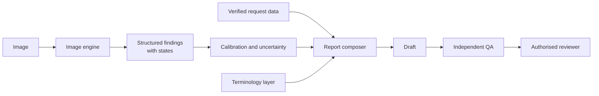

# Report Generation

## The central idea

**Do not ask a model to write a report and then try to find out whether it is true. Establish findings first, then write only what they support.**

Clinical analogy: a house officer who presents the examination findings first, then concludes, can be checked. One who just gives a diagnosis cannot.

## Pipeline



The image engine and report composer are separate services, with a schema between them. Either can be replaced.

## Finding record

```json
{
  "finding_id": "f-0001",
  "exam_id": "synthetic-exam-001",
  "code": "EFFUSION",
  "observation": "pleural effusion",
  "location": {"region": "costophrenic_angle", "laterality": "left"},
  "state": "uncertain",
  "score": 0.61,
  "calibrated_probability": 0.42,
  "evidence": {"type": "heatmap", "uri": "artifact://f-0001", "kind": "explanatory_only"},
  "model": {"name": "baseline-densenet", "version": "0.1.0", "pipeline": "cxr-0.1.0"},
  "source": {"image_id": "synthetic-img-001", "view": "PA"},
  "reviewer_action": null
}
```

All values above are synthetic examples of the format.

## Four states

| State | When | Example text |
|---|---|---|
| `present` | Above the validated upper threshold | "Left pleural effusion." |
| `absent` | Below the validated lower threshold, **and** the finding has a validated rule-out performance | "No pleural effusion." |
| `uncertain` | Between thresholds | "Possible left pleural effusion. Reviewer to confirm." |
| `not_assessed` | No validated model, or area obscured, or limited quality | "Mediastinum: not assessed by AI." |

**A low score does not mean "absent".** This is the key to stopping unsupported negatives. Until a finding has a validated negative predictive value at a stated threshold, its best-supported state is `uncertain` or `not_assessed`. In early prototypes, most sections will read "not assessed". That is honest, and shows exactly where the reviewer must look.

## Hallucination rules

| Must not invent | Enforcement |
|---|---|
| Findings | Composer can only render finding records |
| Clinical history | Only from the verified request field. If blank, "Not provided" |
| Prior examinations | No comparison sentence unless a linked prior exists. Otherwise "None available" |
| Measurements | Only from a measurement record with known spacing |
| Laterality | Only from a location field. Absent laterality renders without a side, and flags QA |
| Recommendations | No generated recommendation in Phase 1 |
| Negative findings | Only with state `absent` |
| Certainty | Language locked to state |

## Template rendering

Each sentence is a function of a record, so every sentence carries a `finding_id`. Deleting the record deletes the sentence.

```text
FINDINGS
Lungs: {lungs}
Pleura: {pleura}
Heart: {heart}
...
IMPRESSION
{only present or uncertain findings, in priority order}

STATUS: AI-GENERATED DRAFT. NOT A REPORT.
```

## Optional LLM phrasing layer (research only, later)

An LLM may rephrase, not add. If used:

1. Input is the finding records, never the image.
2. Output must map each sentence to a `finding_id`.
3. A checker extracts findings, laterality and numbers from the output, and compares them with the input. Any mismatch discards the output and falls back to the template.
4. Credentialed data must follow [L14].

This is an evaluation arm. It is not needed for the prototype.

## Handling inadequate studies

If quality is limited, Technique states it and the affected sections read `not_assessed`. A rotated film should not produce a confident mediastinal statement.

## Research question

Does the hybrid produce fewer unsupported statements than a purely generative model, without unacceptable omission? Measured in [Model evaluation](MODEL_EVALUATION.md).

**Expected trade-off:** the hybrid should fabricate less, and may omit more. Whether that is a good trade depends on review burden and clinical consequence. Omission is dangerous if a reviewer trusts the draft, which is why "not assessed" must be visible rather than silent.

## Limitations

- Templates sound repetitive.
- Coverage is limited to modelled findings. Rare, unmodelled disease is invisible to the AI.
- Heatmaps are not proof. They can look plausible when the model is wrong.
- Cross-image relationships, such as interval change, are out of scope for Phase 1.
