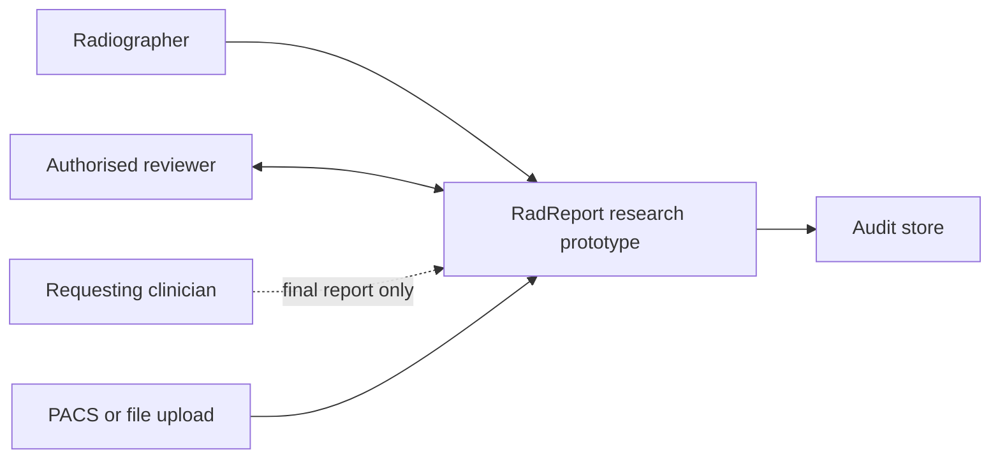
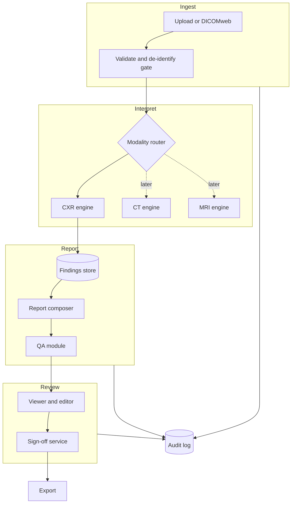
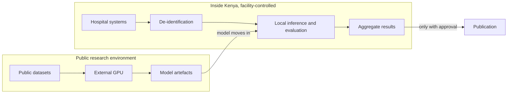

# System Architecture

This is the public conceptual architecture. Implementation detail lives in the private repository.

## Principles

- Modality engines are plugins.
- The image engine is independent from the report engine. They communicate through the findings schema.
- Failure of AI never blocks human reporting.
- Keep it simple until a measured need appears.

## Context

## Components

## Data flow and boundaries

**Model goes to data; data does not go to model.** This follows from the Kenyan legal position. See [Privacy and regulation](PRIVACY_AND_REGULATORY.md).

## Stack decisions

| Layer | Choice | Reason | Rejected or deferred |
|---|---|---|---|
| ML | Python, PyTorch, TorchXRayVision | Standard, teachable | |
| CT and MRI | MONAI, SimpleITK, NiBabel | Fits volumes | Not needed in Phase 1 |
| DICOM | pydicom | Standard | |
| API | FastAPI | Simple, typed | |
| Database | PostgreSQL | Reliable, relational audit | |
| Jobs | Start with a database-backed job table | Fewest moving parts | Redis and Celery deferred until a queue is shown to be needed |
| Prototype interface | Small React page or Streamlit for research | Fast evaluation | |
| Viewer | OHIF (MIT) at P1 | Mature DICOM web viewer | Custom viewer |
| DICOM server | Orthanc to evaluate | Lightweight | Check licence |
| Packaging | Docker Compose | Reproducible | Kubernetes unnecessary |
| Integration | DICOMweb, FHIR, HL7 at later phases | Match real sites | Build after field study |

### Why not Redis and Celery yet

They add services, memory use and failure modes on a small shared server. The first prototype has one user and short jobs.

## Interfaces

| Interface | Direction | Status |
|---|---|---|
| Findings schema | Image engine to composer | Defined, [Report generation](REPORT_GENERATION.md) |
| Report object | Composer to QA and UI | To design |
| Audit event | All to audit store | Defined, [Data dictionary](DATA_DICTIONARY.md) |

## Non-goals in Phase 1

Multi-tenant hosting, live PACS connection, autonomous output, mobile apps, continuous learning. A model that changes itself in deployment would invalidate its validation.

## Failure modes

| Failure | Behaviour |
|---|---|
| Model service down | Reporter works as usual; banner shown |
| Input rejected | Reason shown; no output |
| QA down | Draft cannot be signed in the research workflow; a manual route exists |
| Internet down at site | Local-first design; verify in the field |
